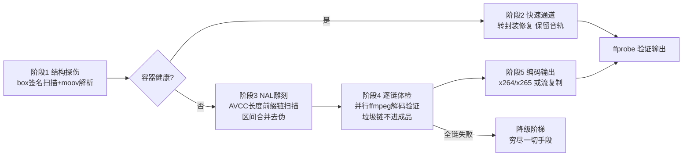

# vfix — 批量视频修复工具

针对「**删除后恢复** / 录制中断 / 索引损坏 / 封装头丢失」的 MP4/MOV 视频做抢救性修复。
单文件、零第三方依赖，只需一个 ffmpeg（便携版可内嵌，双击即用）。

> 典型场景：视频误删后用数据恢复软件找回来，结果打不开 / 花屏 / 只有声音没画面——
> 这类文件的 moov 索引往往已被覆盖，普通修复软件无能为力，vfix 靠**深度雕刻**重建视频流。

## 工作原理



**逐链体检**是成品质量的保证：每条雕刻链独立送 ffmpeg 解码，只有
「零解码错误 **且** 真实解出 ≥1 帧」的链才允许进入成品——悬空参考的 P 帧
链可能零报错但解不出任何图像，靠 `frame=` 统计兜住，杜绝花屏段混入。

**降级阶梯**——全链体检失败 ≠ 没救，穷尽一切手段才判定失败：

| 级别 | 手段 | 治什么 |
|---|---|---|
| ① | 换编码假设（H.264 ↔ H.265）重新雕刻 | 格式判断反了 |
| ② | 改用流内雕刻参数集 | moov 里的参数集是恢复时混入的别人的 |
| ③ | 放宽体检阈值（容忍 <2% 错误） | 个别小错整链被枪毙 |
| ④ | **SPS×PPS 组合快筛**借用参数集 | moov 中 avcC 部分损坏 |
| ⑤ | 容错解码硬啃全部雕刻数据 | 前四级全败后的最后抢救 |

其中 ④ 是精髓：SPS 和 PPS **分开收集候选**（moov 的 / 流内雕刻的 / 健康供体的），
按优先级两两组合、用文件尾部大链秒级快筛。实际案例中 moov 常常只坏一半——
供体的 SPS 配原文件完好的 PPS 才是正解，整把借是行不通的（PPS id 对不上）。

> ⚠️ **供体选择经验**：重编码过的视频（哪怕分辨率相同）不配当供体——
> 编码器的熵编码模式、参数集 id 都不同，借来的参数解不了原流。
> **同设备录制的兄弟文件**才是最佳供体，所以批量修复时把同一批视频放同一目录跑。

## 用法

```bash
# 修复单个文件 / 整个文件夹（递归，自动跳过修复输出）
python vfix.py 坏视频.mp4
python vfix.py D:\恢复出来的视频\

# 常用选项
python vfix.py 视频\ --copy          # 流复制封装：最快且无损（兼容性略低）
python vfix.py 视频\ --preset veryfast
python vfix.py 坏.mp4 --sps-from 健康.mp4   # 手动指定参数集供体
python vfix.py 坏.mp4 --fps 30       # moov 丢失时手动指定帧率
```

Windows 下也可以直接把文件/文件夹拖到 `修复视频.bat` 上。

**输出**：`<输入目录>\修复输出\<原名>_RECOVERED.mp4` + 一份 CSV 修复报告
（Excel 可直接打开，含每文件的状态/帧数/时长/覆盖率/失败原因）。

## 环境

- Python 3.9+（零第三方依赖）
- ffmpeg（需要 libx264；`ffprobe` 可选但强烈建议）
- 查找顺序：`VFIX_FFMPEG`/`VFIX_FFPROBE` 环境变量 → 脚本同目录及 `bin/` →
  `imageio_ffmpeg` 包 → 常见安装路径 → PATH

不想装 Python？用 PyInstaller 打包成单文件 exe：

```bash
pip install pyinstaller
pyinstaller --onefile --clean --noconfirm --name vfixtool \
    --add-binary "ffmpeg.exe;." --add-binary "ffprobe.exe;." \
    --add-binary "avcodec-*.dll;." --add-binary "avformat-*.dll;." \
    --add-binary "avutil-*.dll;." --add-binary "swresample-*.dll;." \
    --add-binary "swscale-*.dll;." vfix.py
```

> 注意：部分发行版的 ffprobe.exe 是 DLL 启动器（仅 200KB），必须连同同目录的
> `avcodec/avformat/avutil/swresample/swscale` DLL 一起分发才能工作。
> vfix 对此有兜底：即使 ffprobe 完全缺失，也会自动退回用 ffmpeg 解码统计来探测输出。

## 设计取舍

- **默认重编码**（x264 CRF17 superfast）：雕刻出的流时间戳已丢失，且坏 NAL
  需要在重编码时被清洗；追求速度/无损用 `--copy`。
- **体检默认开启**：多花几十秒，换成品无花屏段。`--no-triage` 留给赶时间。
- **临时文件复用**：体检工作线程各持一个临时文件反复截断重写，不做海量创建/删除。
- **stderr 落盘**：ffmpeg 的 stderr 用 PIPE 不并发读会缓冲区写满而死锁（踩过的坑）。

## 已知限制

- 纯音频损坏 / 加密视频 / 帧内全被覆盖的数据无法凭空恢复
- 雕刻依赖 AVCC（长度前缀）格式，个别非标封装的裸 Annex B 流不适用
- 数据被覆盖的比例决定了可恢复上限，工具会如实报告覆盖率

## License

[MIT](LICENSE)
